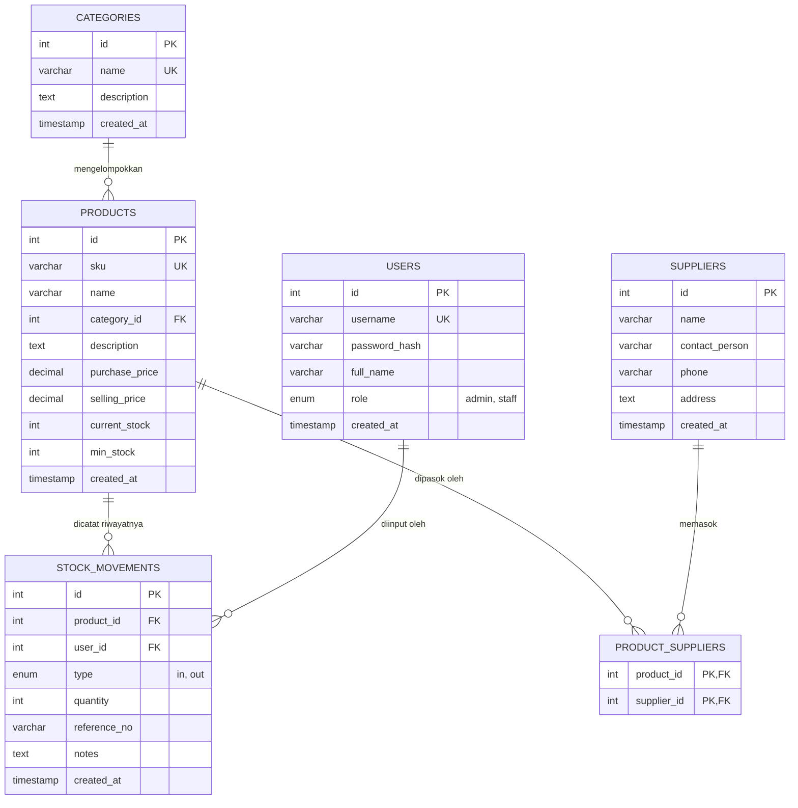

# PANDUAN LENGKAP PENYELESAIAN TUGAS PRAKTIKUM
## PERTEMUAN 4: MINI PROJECT 3 — INVENTORY MANAGEMENT SYSTEM (PHP NATIVE + MYSQL)

Dokumen ini berisi panduan terstruktur sesuai ketentuan slide 38 untuk penyusunan laporan, screenshot, dan pengujian aplikasi.

---

### 1. AKSES DAN KREDENSIAL APLIKASI
- **URL Aplikasi**: `http://localhost/inventory-app/public/login.php`
- **Database MySQL**: `p4_inventory_db` (di XAMPP phpMyAdmin)
- **File Skema Database**: `C:\xampp\htdocs\inventory-app\database\schema.sql` (atau di folder Downloads `p4_schema.sql`)
- **Akun Uji**:
  - **Administrator**: Username: `admin` | Password: `admin123` (Hak akses penuh seluruh modul)
  - **Staff Gudang**: Username: `staff` | Password: `staff123` (Hak akses operasional barang masuk/keluar, dilarang mengakses kelola user)

---

### 2. ENTITY RELATIONSHIP DIAGRAM (ERD)

Struktur relasi database `p4_inventory_db`:

---

### 3. DAFTAR SCREENSHOT FITUR (UNTUK LAPORAN / PPT)

Silakan buka browser ke URL berikut (login sebagai `admin`) dan ambil tangkapan layar (screenshot):

1. **Halaman Login**:
   - URL: `http://localhost/inventory-app/public/login.php`
   - *Fokus*: Tampilan form login yang bersih, responsif, dengan validasi kredensial.
2. **Dashboard Utama**:
   - URL: `http://localhost/inventory-app/public/dashboard.php`
   - *Fokus*: 5 Widget kartu metrik agregat: Total Produk, Total Nilai Inventaris (Rp), Peringatan Stok Kritis/Menipis, Total Transaksi Masuk, Total Transaksi Keluar.
3. **Master Produk (CRUD)**:
   - URL: `http://localhost/inventory-app/public/products/index.php`
   - *Fokus*: Tabel inventaris dengan badge kategori, badge status stok (Aman / Rendah), tombol pagination, pencarian, dan tombol aksi (Tambah, Edit, Hapus).
4. **Master Kategori**:
   - URL: `http://localhost/inventory-app/public/categories/index.php`
   - *Fokus*: Daftar kategori produk beserta tombol tambah dan edit kategori.
5. **Master Supplier**:
   - URL: `http://localhost/inventory-app/public/suppliers/index.php`
   - *Fokus*: Daftar data pemasok (nama kontak, telepon, alamat).
6. **Transaksi Barang Masuk (Stock In)**:
   - URL: `http://localhost/inventory-app/public/stock/in.php`
   - *Fokus*: Form penerimaan barang (pilihan produk, jumlah masuk, no. referensi surat jalan / DO, catatan penerimaan).
7. **Transaksi Barang Keluar (Stock Out)**:
   - URL: `http://localhost/inventory-app/public/stock/out.php`
   - *Fokus*: Form pengeluaran barang gudang (menampilkan stok saat ini agar tidak melebihi kapasitas).
8. **Histori Mutasi Stok**:
   - URL: `http://localhost/inventory-app/public/stock/history.php`
   - *Fokus*: Log riwayat audit transaksi barang masuk (hijau) dan keluar (merah) beserta pencatat nama user dan nomor referensi.
9. **Manajemen User (Admin Only)**:
   - URL: `http://localhost/inventory-app/public/users/index.php`
   - *Fokus*: Tabel pengguna terdaftar dan form penambahan user baru (Admin / Staff).

---

### 4. UJI KASUS 1: VALIDATION ERROR (INPUT GAGAL & ROLLBACK)

**Skenario**: Mencoba mengeluarkan barang gudang dengan jumlah yang melebihi stok yang tersedia.

**Langkah Pengujian**:
1. Login sebagai `admin` atau `staff`.
2. Buka menu **Barang Keluar** di `http://localhost/inventory-app/public/stock/out.php`.
3. Pilih produk yang memiliki stok sedikit, misalnya **Mouse Wireless Logitech B170** (stok saat ini: misal 15 unit).
4. Masukkan **Jumlah Keluar**: `99` (angka yang jauh lebih besar dari stok).
5. Masukkan Nomor Referensi: `OUT-TEST-001`, lalu klik tombol **Simpan Transaksi**.
6. **Hasil yang Diamati & Screenshot**:
   - Muncul alert box berwarna merah bertuliskan:  
     `"Stok tidak mencukupi! Stok saat ini: 15, permintaan keluar: 99"`
   - Database menjalankan `ROLLBACK`, sehingga stok barang tidak berkurang dan data transaksi tidak tersimpan kotor di histori.

---

### 5. UJI KASUS 2: AKSES TERLARANG (HTTP 403 FORBIDDEN)

**Skenario**: Pengguna dengan role `staff` mencoba mengakses modul administrasi hak akses pengguna.

**Langkah Pengujian**:
1. Logout terlebih dahulu dari akun admin melalui menu kanan atas.
2. Login menggunakan akun Staff:
   - Username: `staff`
   - Password: `staff123`
3. Perhatikan bahwa di menu navigasi atas **tidak ada menu "Kelola User"** (karena disembunyikan secara kondisional).
4. Coba lakukan bypass keamanan dengan mengetikkan langsung URL admin di address bar browser:  
   `http://localhost/inventory-app/public/users/index.php`
5. Tekan **Enter**.
6. **Hasil yang Diamati & Screenshot**:
   - Sistem menolak akses dan menampilkan halaman **HTTP 403 Forbidden** (Akses Ditolak).
   - Tampil pesan peringatan: *"Anda tidak memiliki hak akses (role) untuk membuka modul ini. Hubungi Administrator sistem."*

---

### 6. PENJELASAN 7 BUSINESS RULES & ASPEK KEAMANAN (SLIDE 33)

Berikut rangkuman penjelasan yang dapat dimasukkan ke dalam bab pembahasan laporan:

1. **Uniqueness SKU (Stock Keeping Unit)**:
   Setiap produk wajib memiliki kode SKU yang unik di database (`UNIQUE KEY`), mencegah duplikasi identitas produk saat pencatatan gudang.
2. **Nilai Non-Negatif (Data Integrity)**:
   Harga beli, harga jual, stok minimum, dan stok saat ini divalidasi `quantity >= 0`. Tidak diperbolehkan adanya nilai minus pada data kuantitas fisik.
3. **Pencegahan Stok Negatif dengan Database Transaction**:
   Setiap mutasi stok dibungkus dalam blok transaksi `BEGIN TRANSACTION` dan `COMMIT`. Pada saat pengurangan barang, query menggunakan locking `SELECT current_stock FROM products WHERE id = ? FOR UPDATE` untuk mencegah *race condition* (dua staf mengurangi barang secara bersamaan). Jika `stok < permintaan`, query di-`ROLLBACK`.
4. **Foreign Key Integrity (RESTRICT ON DELETE)**:
   Produk yang sudah memiliki riwayat mutasi di tabel `stock_movements` tidak dapat dihapus sembarangan dari sistem (`ON DELETE RESTRICT`), guna menjaga keabsahan riwayat audit keuangan dan inventaris.
5. **Server-Side Authorization (RBAC)**:
   Pengecekan hak akses tidak hanya mengandalkan penyembunyian tombol di tampilan HTML, melainkan diverifikasi ketat di sisi server pada setiap file PHP menggunakan helper `require_admin()` yang memeriksa `$_SESSION['user']['role'] === 'admin'`.
6. **Allowlist Sorting & Filtering**:
   Parameter pengurutan tabel (`?sort=name&order=asc`) divalidasi terhadap daftar kolom yang diizinkan (allowlist array), mencegah manipulasi SQL injection melalui parameter `ORDER BY`.
7. **Prepared Statements (Anti-SQL Injection)**:
   Seluruh query interaksi database menggunakan PDO Prepared Statements (`$stmt->prepare()` dan `$stmt->execute([...])`), sehingga input dari pengguna diperlakukan murni sebagai parameter data, bukan kode SQL yang dapat dieksekusi.
